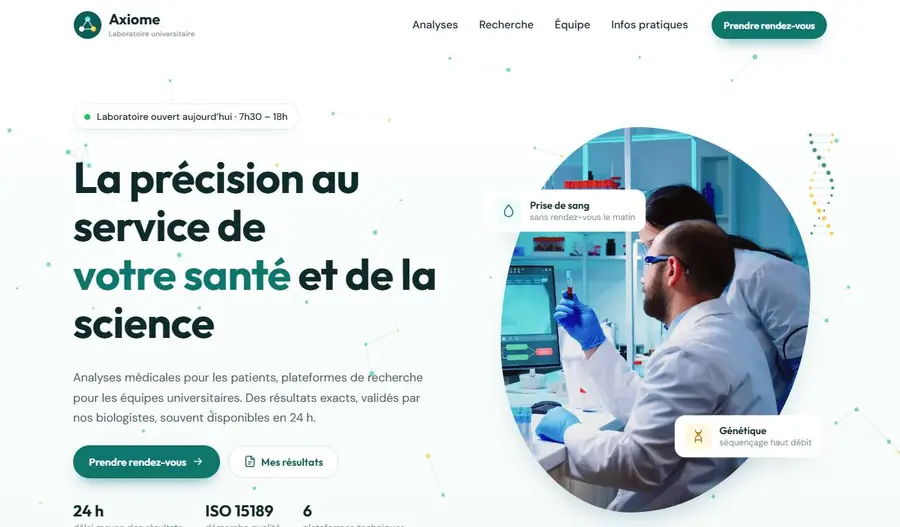

# Modèle laboratoire — Laboratoire Axiome

Medical & university research lab website template (French): analysis search, research topics, animated molecules. Plain HTML/CSS/JS.

**Live demo:** https://abdelmoulabilel.github.io/research-lab-template/

## Use it
- Click **Use this template** on GitHub (or download the ZIP), then open `index.html` — no install, no build.
- Publish for free: repo **Settings → Pages → Deploy from branch → main / root**.

## Customise
Textes dans `index.html`, couleurs dans `css/style.css` (`:root`).
Axes de recherche et e-mail : en haut de `js/main.js` (`AXES`, `CONTACT_EMAIL`).
Les noms de l’équipe sont fictifs.

## Credits
Code: MIT licence (see `LICENSE`). Photos come from earlier client projects or theme demos and are for demonstration only — replace them with your own images.
